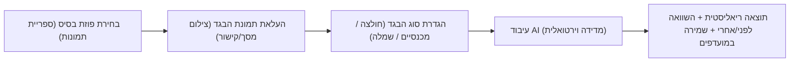

# מסמך אפיון מוצר וטכנולוגיה: מערכת מדידה וירטואלית אישית (Virtual Try-On)

## 1. חזון הפרויקט
מערכת פרטית, מאובטחת ואינטואיטיבית המאפשרת למשתמשת (אשתך) לראות כיצד בגדים מאתרי אונליין נראים עליה בדיוק ובאופן ריאליסטי, על בסיס מודלי AI מתקדמים ותמונות בסיס אישיות שלה.

---

## 2. חוויית המשתמשת (User Flow)

1. **בחירת פוזה / תמונת בסיס:**
   - ספרייה מוכנה של 5–10 תמונות אישיות שלה בפוזות שונות (עמידה ישרה, מבט מהצד, ישיבה, שיער אסוף / פזור, תאורה ניטרלית).
2. **הזנת הבגד:**
   - העלאת צילום מסך או תמונה מאתר הקניות (זארה, שיין, אסוס וכו').
   - *אופציונלי (שלב מתקדם):* הדבקת קישור למוצר וחילוץ התמונה אוטומטית.
3. **בחירת קטגוריה:**
   - חלק עליון (Upper Body), חלק תחתון (Lower Body), שמלה/אוברול (Full Body).
4. **תצוגת התוצאה:**
   - הצגת תמונת התוצאה לצד תמונת המקור (מצב Split View / Slider לפני ואחרי).
   - אפשרות לשמור ל-"ארון המועדפים" (Saved Outfits) כולל קישור ישיר לרכישה.

---

## 3. מנוע ה-AI למדידה וירטואלית (הלב של המערכת)

כדי להגיע לתוצאה ברמה גבוהה מאוד (High Fidelity), יש שתי דרכים מרכזיות ליישום:

### אופציה א': שימוש ב-APIs קיימים ומודלים מתקדמים (מומלץ להתחלה מהירה ויציבה)
* **IDM-VTON (State-of-the-Art Virtual Try-On):**
  - מודל הקוד-פתוח המוביל כיום בעולם המדידה הווירטואלית. שומר על טקסטורת הבגד, קפלים, והתאמה מדויקת לגוף.
  - ניתן להרצה דרך שירות ענן כמו **Replicate** או **Fal.ai** בעלות אפסית לפי שימוש (כ-0.02\$ עד 0.05\$ לתמונה).
* **Kling / Kolors Virtual Try-On API:** חלופות נוספות עם איכות רינדור גבוהה מאוד.

### אופציה ב': מודל גנרטיבי רב-תכליתי (ComfyUI / Stable Diffusion / FLUX)
* הרצה מקומית או בשרת GPU ייעודי (דורש מחשב עם כרטיס מסך חזק 12GB+ VRAM).
* מאפשר התאמה אישית מלאה (LoRA של תווי הפנים של אשתך).

> [!TIP]
> **המלצה:** נתחיל עם **IDM-VTON דרך API (Fal.ai או Replicate)**. זה ייתן תוצאה פוטו-ריאליסטית מהרגע הראשון ללא צורך בהשקעה של כרטיס מסך יקר או הגדרות מסובכות.

---

## 4. ארכיטקטורה טכנולוגית מוצעת

| רכיב | טכנולוגיה מומלצת | סיבה לבחירה |
| :--- | :--- | :--- |
| **Frontend** | **React / Next.js** (או Streamlit לגרסת אבטיפוס מהירה) | ממשק אלגנטי, מותאם למובייל (כדי שתוכל להשתמש מהטלפון בנוחות), מהיר וקל לעיצוב. |
| **Backend** | **Python (FastAPI)** | אינטגרציה קלה עם עיבוד תמונה (PIL, OpenCV) ושליחת בקשות למודלי ה-AI. |
| **אחסון תמונות** | מקומי (Local Storage) או Cloudinary / Supabase Storage | פשוט ופרטי. |
| **מנוע Try-On** | **IDM-VTON API** | האיכות הגבוהה ביותר הקיימת היום בשוק. |

---

## 5. פיצ'רים ייחודיים שיעשו את זה מושלם עבורה
1. **התאמה מלאה למובייל:** שתוכל לגלוש באתר תוך כדי שהיא פותחת אפליקציות שופינג בטלפון.
2. **ארון בגדים אישי (Wardrobe History):** תיעוד של כל הבגדים שהיא מדדה, עם אפשרות לדרג (❤️ / 👎).
3. **הסרת רקע אוטומטית לבגד:** אם היא חותכת תמונה עם דוגמנית, המערכת תבודד את הבגד בלבד כדי להלביש אותו בצורה נקייה.

---

## 6. תוכנית עבודה מוצעת בשלבים

- **שלב 1 (MVP - תוך כמה ימים):** 
  - הקמת סקריפט/בקאנד פשוט שמקבל תמונת גוף + תמונת בגד ומחזיר תמונה מולבשת באיכות גבוהה דרך API.
- **שלב 2 (ממשק משתמש אלגנטי):**
  - בניית דף אינטרנט נוח עם גלריית תמונות שלה וכפתור העלאה פשוט.
- **שלב 3 (שדרוגים ונוחות):**
  - שמירת מועדפים, שיתוף ישיר, ועיצוב נקי ויוקרתי.
